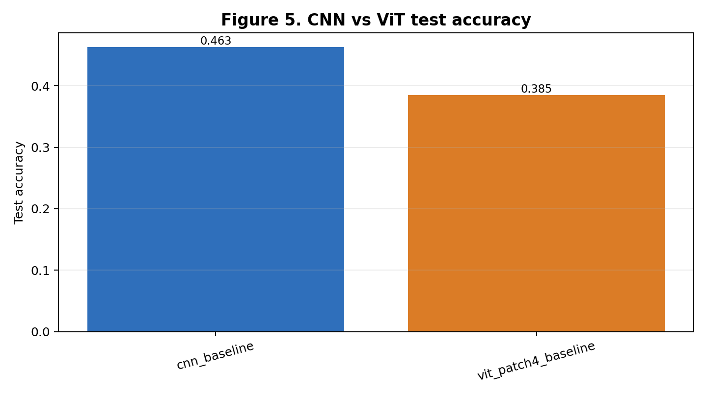

# CNN과 Vision Transformer 비교

**Python · PyTorch · torchvision · scikit-learn · Matplotlib**

CIFAR-10의 작은 이미지·제한된 학습 조건에서 CNN과 ViT를 비교한 수업 과제입니다.
ViT의 patch 크기, 모델 용량, pooling·augmentation을 바꾸면 정확도·토큰 수·학습 시간이 어떻게 달라지는지 살펴봤습니다.

## Code & records

- [학습·평가 코드](src/run_vit_assignment.py)
- [기존 모델별 결과](runs/metrics.csv), [epoch별 기록](runs/history.csv), [실행 설정](runs/run_config.json)

기존 실행: train 7,000 / validation 2,000 / test 3,000장, 클래스별 균등 부분집합, 6 epochs, batch 128, seed 42, CPU. 저장 환경의 torch 버전은 2.11.0입니다.

| 설정 | Test accuracy | Parameters | 학습 시간(초) |
| --- | ---: | ---: | ---: |
| CNN baseline | 46.30% | 141,354 | 79.11 |
| ViT patch 4 | 38.47% | 236,554 | 53.37 |
| ViT patch 8 | 34.37% | 245,770 | 22.70 |
| ViT patch 16 | 34.57% | 299,914 | 19.44 |
| ViT small | 33.10% | 75,082 | 25.50 |
| ViT large | 37.87% | 546,186 | 80.18 |
| ViT mean pooling + Cutout | 35.73% | 236,362 | 48.18 |



## What I learned

patch를 키운 두 설정은 patch 4보다 학습 시간이 짧았고 정확도가 낮았습니다. 작은 모델은 파라미터와 시간이 줄었지만 정확도도 낮았습니다.
mean pooling + Cutout 변형의 정확도는 baseline ViT보다 **2.73%p 낮았습니다**. 변형이 성공했다고 포장하지 않고 실패 결과와 오분류 양상을 함께 검토하는 사례로 남깁니다.

이 조건에서는 CNN이 더 높은 정확도를 보였습니다. 서로 다른 학습률, 단일 seed, 6 epochs, 부분집합이라는 제약이 있어 공정한 대규모 벤치마크나 일반적인 CNN 우위의 증거는 아닙니다.

## Run

Python 3.10 이상에서 별도 가상환경을 사용합니다. 설치·학습은 계산 자원과 데이터 다운로드를 사용합니다.

```bash
cd ViT-CIFAR10
python -m pip install -r requirements.txt
python src/run_vit_assignment.py --epochs 6 --train-per-class 700 --val-per-class 200 --test-per-class 300 --batch-size 128 --seed 42
```

실행하면 이 폴더의 `runs/`, `figures/`가 새 결과로 바뀝니다. 저장된 과거 기록을 유지하려면 별도 복사본에서 실행하세요.
코드는 가용 장치를 자동 선택하므로 새 실행은 저장 기록의 CPU 조건과 다를 수 있습니다. 표는 기존 기록 기준이며 포트폴리오 공개 때 전체 재학습하지 않았습니다.

## Learning context

영상AI생성모델 수업 과제. UvA Vision Transformer 튜토리얼을 참고한 학습 맥락에서 작은 CNN·ViT 및 변형 설정을 비교했습니다.
이 저장소에서는 기존 과제의 실행 스크립트와 결과 기록을 선별해 보존했습니다. 참고 튜토리얼 전체 코드를 복제한 저장소가 아닙니다.

[UvA Tutorial 15](https://uvadlc-notebooks.readthedocs.io/en/latest/tutorial_notebooks/tutorial15/Vision_Transformer.html)
